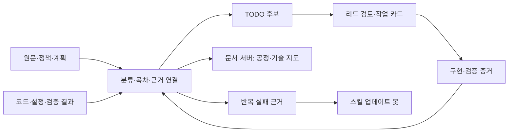

# 프로젝트 지식·개발 공정 정리 봇 분석 및 개발계획

> 작성 기록: 2026-11-17 20:08:58 KST · 최종 수정: 2026-11-17 21:11:33 KST
> 작성 기록은 최초 Git 커밋 시각이며, 실제 초안 작성 시각과 다를 수 있습니다.

## 요청과 목표

사용자 요청: 계획안·정책·개발 내용을 분류하고 분류 목차를 정리하며, 해당 내용에 근거한 TODO·공정 시각화와 기술 스택·구조 설명을 제공하는 에이전트 봇을 분석하고 계획한다.

가칭 `프로젝트 정리 봇`은 “무엇을 만들고, 어떤 규칙을 따르며, 어디까지 진행했고, 코드가 어떻게 구성됐는가”를 한곳에서 이해하도록 돕는다. 문서 요약뿐 아니라 원문·결정·작업·실제 구현 사이의 연결과 불일치를 관리한다. 이번 산출물은 계획 초안이며 봇·화면·자동 실행은 아직 구현하지 않는다.

## 현재 체계 분석

| 확인한 기존 자산 | 재사용할 부분 | 추가로 필요한 부분 |
|---|---|---|
| 지식 관리 가이드의 00~99 분류 | 저장 위치, 날짜·ID·상태, 문서 생명주기 | 정책 세부 분류, 내용별 연결, 충돌 처리 |
| 문서 색인 생성기·가이드 브라우저 | 파일·제목·소제목 색인과 원문 탐색 | 정책·요구사항·작업의 의미 관계와 공정 보기 |
| 작업 카드·STATE | 담당, 의존 카드, 완료 조건, 검증 증거 | 근거에서 후보 TODO 추출, 변경 영향 추적 |
| 기존 plan·docs·audit 역할 | 기획, 매뉴얼 작성, 독립 검토 | 작업 전후를 아우르는 정리·갱신 책임 |
| 문서 서버와 agent-deck 역할 분리 | 문서 서버는 참고자료·입출력, TUI는 봇 현황·소통 | 정리 결과의 문서 서버 표시와 실행기 연결 계약 |

현재 색인 생성기는 경로별 그룹과 헤딩을 수집한다. 의미 분류나 작업 의존 관계를 검증하는 구현으로 보지 않는다. 현재 문서 편집 서버는 기존 Markdown 수정만 허용하므로 새 문서·작업 카드 생성 API가 이미 있다고 가정하지 않는다.

## 역할과 운영 경계

- 프로젝트 정리 봇: 근거 수집, 분류 제안, 요약·목차·TODO 후보·구조 설명·시각화 자료 생성.
- 기존 `plan`: 목표·범위·우선순위·일정과 작업 분해 확정. 봇의 후보를 실행 카드로 채택한다.
- 기존 `docs`: 사용자·운영 매뉴얼 작성. 정리 봇은 매뉴얼을 분류·연결하고 오래된 내용을 표시한다.
- 기존 `audit`·`qa`: 근거 일치, 분류·상태·화면의 정확성 검증. 리드는 승인된 변경을 Git으로 반영한다.
- [스킬 업데이트 봇](2026-11-17__development__skill-update-bot.md): 정리 과정에서 반복되는 스킬 실패를 개선 후보로 받는다. 프로젝트 정책은 스킬 개선으로 자동 승격하지 않는다.

처음에는 기존 역할 세션에서 수동 호출하는 작업 흐름으로 시험한다. 전용 역할 등록과 스케줄러는 효과 확인 후 결정하며 현재 역할 7종을 즉시 늘리지 않는다. 템플릿에는 계약·양식·출력 규칙을 두고, 상주 실행기와 다중 프로젝트 상태 관리는 별도 런타임에 둔다.

## 분류 체계와 목차

기존 폴더를 재사용하고 분류 축을 추가한다. 주 분류는 하나, 교차 주제는 태그와 참조로 표현한다. 아래는 소비 프로젝트에 생성할 목차의 제안이며 이번에 기존 문서를 이동하지 않는다.

| 사용자용 목차 | 정본 위치 | 주요 내용 |
|---|---|---|
| 프로젝트 한눈에 | project-guide 및 분류 문서 링크 | 목표, 범위, 현재 단계, 미결정 사항 |
| 입력 자료 | 00-inbox | 원문, 회의·아이디어, 미분류 자료 |
| 개념·조사 | 01-concept / 02-whitepaper | 용어, 문제 정의, 조사 출처 |
| 요구사항·제품 정책 | 03-product | 기능, 업무 규칙, 대상·예외·성공 기준 |
| 설계 | 04-design | 화면, 데이터, 인터페이스, 상태 전이 |
| 개발계획·TODO·기술 구조 | 05-development 및 docs/tasks | 마일스톤, 작업 카드, 스택·폴더·모듈 설명 |
| 운영 정책 | 06-operations | 운영·보안·배포·장애 대응 기준 |
| 결정 이력 | 07-decisions | 선택 이유, 적용 범위, 대체한 결정 |
| 검증·리포트 | 90-reports | 테스트·리뷰·진척·불일치 보고서 |
| 이전 문서 | 99-archive | 폐기·대체된 문서와 현행 문서 링크 |

개발 방식·코딩 정책은 기존 프로젝트 로컬 가이드 및 관련 가이드가 정본이다. 봇은 정책을 한 파일로 복제하지 않고 제품/개발/운영별 목차에서 해당 정본으로 연결한다. 초안·확정·폐기를 표시하며 최신 수정 날짜만으로 정책을 확정하지 않는다. 규칙 충돌은 적용 범위·문서 우선순위·확정된 결정을 대조하고 해결할 근거가 없으면 확인 필요로 남긴다.

긴 원문은 주제별 요약으로 나누되 출처와 문단 위치를 보존한다. 물리적인 분리·이동·보관은 링크 영향과 변경안을 먼저 제시하고 해당 작업의 승인 범위 안에서 수행한다.

## 데이터와 근거 연결

Markdown을 정본으로 유지하고 JSON 색인·화면은 재생성 가능한 파생물로 둔다. 기존 메타데이터를 재사용하며 아래 필드는 추가 계약 제안이다. 작업 카드와 중복되는 상태 저장소는 만들지 않는다.

| 대상 | 필요한 정보 |
|---|---|
| 문서 | 불변 ID, 유형·상태, 범위, 태그, 원문 경로·절, 갱신일, 기준 commit 또는 콘텐츠 해시 |
| 정책 | 정책 ID, 적용 대상, 규칙·예외, 확정 근거, 대체 관계 |
| 요구사항 | 요구사항 ID, 출처, 정책 참조, 완료 조건 |
| 작업 후보 | 후보 ID, 근거 요구사항, 제안 이유, 의존성, 미결정 사항, 채택된 카드 ID |
| 실행 카드 | 기존 카드 ID·담당·상태·완료 조건·증거, 근거 문서·요구사항 연결 |
| 기술 요소 | 이름, 용도, 선언 버전·잠금 버전·실측 버전 구분, 근거 경로, 확인 시점 |

관계 유형은 `근거로 함`, `구현함`, `의존함`, `검증함`, `대체함`으로 제한해 시작한다. 모든 요약·TODO·구조 설명에서 원문으로 돌아갈 수 있어야 한다. 파일 이름이 바뀌어도 ID를 유지하며, 삭제·대체된 근거는 연결 오류로 표시한다.

## TODO와 공정 관리

1. 요구사항과 완료 조건에서 후보 TODO를 추출한다. 미정 정책이 선행 조건이면 보류 이유를 함께 만든다.
2. 기존 카드와 근거 ID·목표·범위를 비교해 중복을 막는다. 후보 생성은 작업 승인이나 실행 시작을 뜻하지 않는다.
3. 리드가 채택한 후보만 기존 `docs/tasks/<ID>.md` 실행 카드에 연결한다. 담당·우선순위·일정의 미정 값은 비워 둔다.
4. 상태는 기존 `대기 → 진행 → 리뷰 → 테스트 → 완료`와 `보류`를 사용한다. 의존 카드 미완료와 순환 의존성은 별도 차단 사유로 표시한다.
5. 카드 진행률은 기존 규칙대로 완료 조건 체크 비율이다. 프로젝트 요약은 완료 카드 수/전체 카드 수를 별도로 표시하고 분모·기준 시점을 공개한다. 이를 작업 시간이나 제품 완성도로 표현하지 않는다.
6. 완료 상태는 필수 완료 조건과 검증 증거가 일치할 때만 표시한다. 커밋 존재·세션 종료·체크 표시만으로 완료를 추론하지 않는다. 불일치하면 확인 필요 배지를 붙인다.
7. 근거 정책이 바뀌면 연결된 설계·카드·테스트를 영향 후보로 표시한다. 완료 작업을 몰래 다시 열거나 새 요구사항을 자동 승인하지 않는다.

## 시각화 구성과 사용 흐름

문서 서버에 정리 결과를 표시하는 방향이다. 최초 화면은 읽기 전용이며 `요약 → 상세 → 원문·검증 증거` 순으로 탐색한다.

| 보기 | 보여 줄 내용 | 판단에 도움이 되는 장치 |
|---|---|---|
| 분류 목차 | 유형·주제·상태별 문서와 소제목 | 검색, 미분류·충돌·오래된 문서 필터 |
| 프로젝트 요약 | 목표, 현 단계, 최근 변경, 미결정 사항 | 확인 시점·기준 commit·근거 링크 |
| TODO 보드 | 상태별 카드, 담당, 선행 작업 | 실행 후보와 승인된 카드 구분, 차단 사유 |
| 공정 흐름 | 기획→설계→개발→검증→문서화 및 의존 관계 | 카드 연결, 병목, 생략 단계와 이유 |
| 로드맵 | 마일스톤과 완료 조건 | 일정 미정 표시; 날짜·추정 근거가 있을 때만 시간축 |
| 기술 지도 | 스택, 디렉터리 책임, 모듈 관계, 요청·데이터 흐름 | 선언/관측/추정 구분, 코드 위치로 이동 |
| 변경 영향 | 바뀐 정책에서 연결된 설계·작업·테스트 | 재검토 대상과 확인 완료 구분 |

위 Mermaid는 계획을 설명하는 다이어그램이다. 기존 문서 브라우저에서 Mermaid 렌더링을 지원한다고 가정하지 않는다. HTML 구현 시에는 외부 의존성 없는 DOM/SVG로 기본 보드·흐름을 만들고, 같은 내용을 표·텍스트로도 제공한다. 복잡한 그래프 라이브러리는 별도 판단 대상이다.

화면 구현 시 `DESIGN.md`와 디자인 가이드를 적용한다. 로딩·빈 자료·파싱 실패·근거 소실·갱신 필요 상태, 키보드 탐색과 좁은 화면을 검증한다. 화면에서의 임시 조작을 저장 완료로 표시하지 않으며, 기존 localStorage와 저장소 기록을 구분한다. 문서 생성·카드 수정 UI는 후속 단계에서 승인·충돌 처리와 함께 설계한다.

## 기술 스택·구조 설명 방식

- 스택: manifest·lockfile·빌드 설정·Compose·실행 명령에서 확인한다. 의존성 선언만으로 실제 사용 중이라고 단정하지 않는다. 이 작업은 스택 교체·업그레이드 추천이 아니다.
- 구조: 자동 생성물·vendor·비밀 파일을 제외한 디렉터리 트리에 폴더별 책임과 대표 진입점을 붙인다. 모노레포는 앱·패키지 경계를 먼저 보여 준다.
- 흐름: 확인된 import·라우트·호출 관계로 대표 사용자 동작 1개의 요청→처리→저장→응답을 설명한다. 정적 분석으로 확인하지 못하는 동적 호출은 미확인으로 남긴다.
- 설명: 쉬운 한 문장 용도, 개발자용 상세, 원문·코드 링크의 3단계로 제공한다. 용어집과 예시를 함께 두되 저장소에 없는 API·DB·배포 구성을 만들어내지 않는다.
- 계획과 실제 구현이 다르면 두 상태와 확인 시점을 나란히 보여 주고 불일치 보고서를 만든다.

봇 자체의 MVP는 기존 Markdown·파일 기반 색인·Node 유지보수 도구·단일 HTML 관례를 활용하는 안이다. 새로운 DB·벡터 검색·클라우드 서비스는 필수로 두지 않는다. 구조화와 검증은 결정적인 코드로, 의미 분류·쉬운 설명은 에이전트가 수행하도록 나눈다. 구체 파서·모델·스키마 버전은 첫 구현 때 확정한다.

## 갱신과 실패 처리

명시적 호출로 시작하고 이후에는 문서·카드·코드 변경 후 증분 갱신을 검토한다. 기준 해시가 바뀐 항목과 연결된 파생물만 재검토하고, 같은 입력은 같은 ID·정렬 결과를 유지한다. 생성 영역과 사람이 작성한 영역을 분리해 덮어쓰기를 막는다.

충돌·파싱 실패 시 정본을 그대로 두고 오류와 마지막 정상 생성 시점을 표시한다. 생성물은 임시 파일에서 검증 후 교체한다. 작업 도중 정본이 바뀌면 재분석하며 다른 세션의 편집을 덮어쓰지 않는다. 원문 속 실행 지시를 명령으로 수행하지 않고 수집 범위·민감 정보 제외 기준을 지킨다.

## 개발 단계와 검증

| 단계 | 산출물 | 완료 조건 |
|---|---|---|
| 1. 계약·사례 | 분류 기준, ID·관계 계약, 예시 문서·카드 | 정책/계획/결정 구분, 기존 가이드·카드와 충돌 없음 |
| 2. 문서 정리 MVP | 수동 호출 분류·목차·요약·TODO 후보 | 모든 후보에 출처·완료 조건, 재실행 중복 0, 정본 무단 변경 0 |
| 3. 화면 초안·계약 검증 | mock 자료로 목차·보드·공정·기술 지도 | 요약→원문 탐색 가능, 데이터 계약 확정, 목업 표기 |
| 4. 실제 데이터 연결 | 카드·검증·스택·구조와 증분 갱신 | 아래 검증 사례 통과, 불일치·갱신 시점 표시 |
| 5. 실행기 연동 | 역할 호출·중복 실행 방지·선택적 자동 갱신 | 승인된 범위 준수, 실패 시 정본 보존, 중지·재개 확인 |

1~2를 첫 구현 단위로 제안한다. 현재 개발 우선순위나 agent-deck GUI 착수 조건은 이 초안으로 바꾸지 않는다.

필수 검증 사례: 정책 충돌·초안/확정 혼재, 문서 이동·삭제·중복 ID, 순환·누락 의존성, 근거 없는 TODO, 체크 완료지만 테스트 실패, 선언 버전과 잠금 버전 차이, 계획과 코드 불일치, 변경 중 동시 편집, 파싱 실패·재실행 멱등성. 링크·관계 오류 0, 상태 오표시 0, 기존 회귀 검사 통과를 기준으로 한다. 의미 분류는 사람이 확정한 표본과 비교해 오분류·보류를 따로 집계하며 목표 정확도와 표본 크기는 1단계에서 정한다.

## 근거 문서와 미결정 사항

- 기준: [지식 관리](../knowledge-management-guide.md), [작업 카드](../../templates/task-card.md), [역할 봇](../../agents/roles/README.md), [협업 운영](../claude-codex-collaboration.md), [개발 전략](../development-strategy.md), [구조 가이드](../framework-structure-guide.md), [승인 절차](../approval-workflow.md).
- 코드 근거: `scripts/build-docs-index.mjs`, `scripts/serve-docs.mjs`, `docs/guide-browser.html`을 2026-11-17 확인했다. 실제 런타임 연동은 이번에 조사·수정하지 않았다.
- 첫 적용 프로젝트·대표 문서 표본, 신규 역할의 필요성, 분류 검수 담당, 모델·실행 예산, 갱신 주기는 미정이다.
- 일정은 구현 범위와 표본 검증 후 산정한다. 외부 서비스 연결이나 전체 문서 일괄 이동은 별도 범위로 둔다.
