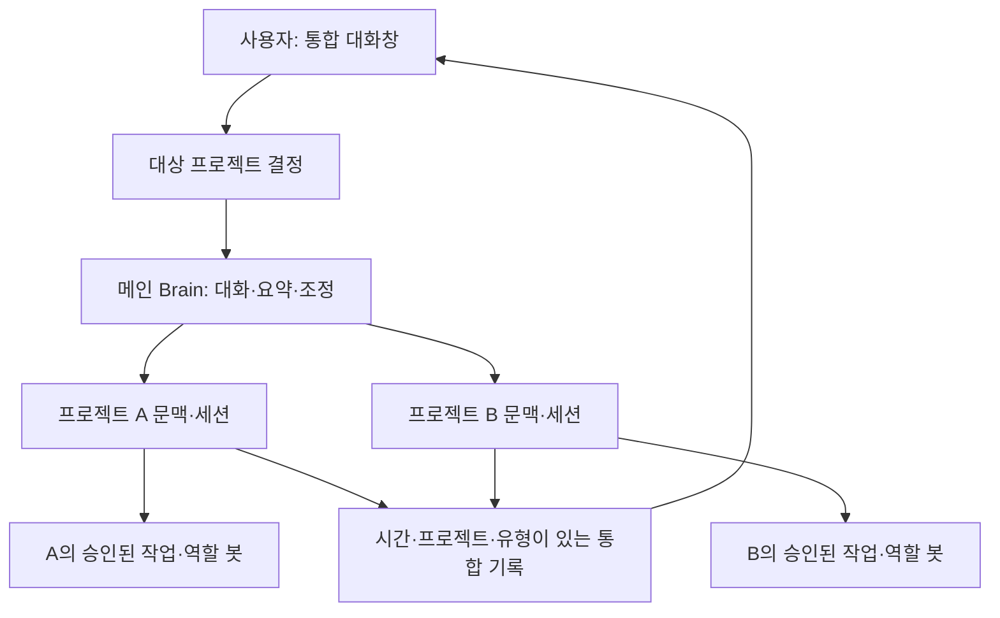

# 메인 Brain·프로젝트 지정 대화 개발계획

> 작성 기록: 2026-11-17 21:08:09 KST · 최종 수정: 2026-11-17 22:34:34 KST
> 작성 기록은 최초 Git 커밋 시각이며, 실제 초안 작성 시각과 다를 수 있습니다.

## 요청과 적용 상태

사용자는 프로젝트별 Brain 대신 메인 Brain 하나로 대화하고, 프로젝트를 수동 선택하거나 메시지에서 지정하며, 대화마다 시간·프로젝트·내용 유형을 표시하는 안을 검토한 뒤 개발계획에 추가하도록 요청했다.

계획 방향은 **메인 Brain 하나와 통합 대화창, 프로젝트별 문맥·승인·실행 범위 분리**다. 현재의 프로젝트별 Brain 세션은 전환 과정에서 재사용한다. 모든 프로젝트의 대화와 권한을 하나의 모델 세션에 합치는 방식은 채택하지 않는다. 이 문서는 개발을 위한 초안이며 실제 구현 착수·배포를 의미하지 않는다.

## 현재 구현과 변경 이유

2026-11-17 읽기 전용 검토에서 agent-deck의 다음 구조를 확인했다. 착수 시 최신 코드에서 다시 확인한다.

- `src/brain.rs`: Brain마다 프로젝트 경로·Claude 세션을 보관하고 해당 프로젝트 작업 명령을 허용한다. 메시지는 시간·발신자·본문을 저장한다.
- `src/gui.rs`: Brain ID로 메시지 대상을 찾으며 프로젝트별 최근 대화를 웹 API로 제공한다.
- `gui/index.html`: 웹 대화에는 발신자와 시간이 표시된다. 프로젝트는 선택된 Brain 문맥에 속하고 메시지별 유형은 없다.
- `src/main.rs`: TUI 대화 본문은 발신자와 내용을 표시한다.

현재 구성을 단순히 한 세션으로 합치면 프로젝트 정책과 승인 문맥이 섞이고 실행 대상이 잘못 선택될 위험이 있다. 통합 창구와 내부 격리를 분리하면 한곳에서 대화하면서 기존 실행 경계를 유지할 수 있다.

## 구성과 책임



- 메인 Brain은 사용자 창구와 조정 역할이다. 처음에는 통합 UI와 라우터로 구현하고, 이후 공통 요약·프로젝트 간 비교 기능을 더한다.
- 프로젝트 문맥은 해당 가이드·정책·결정·작업 상태와 근거 링크를 보관한다. 필요한 문맥만 요청에 제공하고 다른 프로젝트의 원문 전체를 매번 넣지 않는다.
- 실행 담당은 선택된 프로젝트의 세션·리드다. 프로젝트 변경 시 이전 세션의 작업 디렉터리나 허용 명령만 바꿔 재사용하지 않는다.
- 전체 대화 보기와 실행 대상 선택은 별개다. 기록 필터를 바꿔도 입력 대상은 자동 변경되지 않는다.
- 기존 승인·머지·배포 경계는 그대로 유지한다. 프로젝트 선택과 내용 유형 지정 자체는 실행 승인이 아니다.

## 프로젝트 지정 규칙

| 상황 | 처리 |
|---|---|
| 선택기로 A 지정 | 입력창에 `대상: A` 표시, 이후 메시지의 기본 대상 유지 |
| 메시지 앞의 명시적 `@B` | 해당 메시지만 B로 전송, 기본 선택은 A 유지 |
| “앞으로 B로 전환” | 전환 이벤트를 기록하고 기본 대상 B로 변경한 사실 표시 |
| 본문에 B를 설명·비교 대상으로 언급 | 자동 전환하지 않음; 실행 대상과 참고 대상을 구분 |
| 프로젝트 미선택 | 공통 대화 가능; 프로젝트 작업 요청이면 대상 지정 필요 |
| 이름 중복·알 수 없는 별칭·명시 대상 충돌 | 경로 등 식별 정보를 보여 주고 대상 결정 전 전달 보류 |
| 전체/공통 선택 | 현황·비교·공통 기획용. 작업은 프로젝트별 카드로 분리 |
| 선택한 프로젝트가 삭제·접근 불가 | 다른 프로젝트로 대체하지 않고 대상 오류 표시 |

우선순위는 **해당 메시지의 명시적 대상 → 현재 수동 선택 → 공통**이다. `@` 지정은 입력창의 대상 칩으로 변환해 전송 전 확인 가능하게 한다. 인용·코드블록·일반 본문의 프로젝트명은 지시로 해석하지 않는다. 한 메시지에 여러 프로젝트의 작업을 요청하면 대상 목록과 분해안을 먼저 만들고 각 프로젝트의 승인 범위로 전달한다.

전송 시 서버가 대상 ID·프로젝트 문맥 버전·요청 ID를 확정한다. 화면 선택이 바뀌어도 진행 중인 응답·재시도·작업은 원래 대상을 유지한다. 승인 응답은 원래 요청/작업 ID에 연결하고 다른 프로젝트에 재사용하지 않는다. 단순한 “진행해”의 대상이 여러 개면 확인한다.

## 대화 표시와 탐색

```text
입력 대상: 프로젝트 A ▾    기록 필터: 전체

2026-11-17 15:42 KST · 프로젝트 A · 사용자 · 정책 검토
회원 가입 승인 정책을 정리해줘.

2026-11-17 15:43 KST · 프로젝트 A · Brain · 검토 결과
현재 정책과 미결정 사항을 정리했어요.
관련: 회원 정책 문서 · T-023
```

- 유형: 질문, 요구사항, 계획, 정책, 작업 지시, 진행 보고, 검토 결과, 결정, 미분류. 표시용 유형과 실제 작업 상태·승인 상태를 분리한다.
- 자동 분류는 수정 가능하게 하고 변경 이력을 남긴다. `결정` 유형을 붙였다는 이유만으로 정책을 확정하거나 실행을 승인하지 않는다.
- 프로젝트명·시간·발신자·내용 유형은 메시지마다 표시한다. 공통 대화는 `공통`, 다중 프로젝트 비교는 관련 프로젝트 목록을 표시한다.
- 저장 시각은 서버 UTC, 화면은 사용자 시간대와 날짜를 포함해 표시한다. 기본 표시 제안은 Asia/Seoul이며 시간대 전환을 지원할지는 UI 구현 때 확정한다.
- 프로젝트·유형·기간·관련 작업으로 필터링하고 검색 결과에서 원래 대화·근거 문서로 이동한다. 프로젝트명 변경 후에도 과거 대상 ID는 유지한다.
- 웹과 TUI의 필수 표시 정보는 같게 한다. 좁은 화면에서도 대상 프로젝트와 응답 연결을 숨기지 않는다. 접근성은 색상 외 텍스트와 키보드 탐색으로 검증한다.
- 화면 구현 시 DESIGN.md와 해당 런타임의 로컬 디자인 규칙을 따른다. 이 문서의 Mermaid는 설명용이며 기존 문서 브라우저의 렌더링 지원을 전제하지 않는다.

## 메시지·라우팅 계약 초안

| 필드 | 의미 |
|---|---|
| schema_version, message_id | 형식 버전, 메시지 고유 ID |
| conversation_id, request_id, reply_to | 대화·요청·응답 연결; 지연 응답의 대상 보존 |
| project_id, related_project_ids | 단일 실행 대상 또는 공통(null), 비교·참고 대상 목록 |
| project_label_snapshot | 전송 당시 사용자에게 보인 프로젝트명 |
| scope_source | 선택기, 명시 지정, 공통 중 대상 결정 근거 |
| created_at, sequence | 서버 UTC 시각, 같은 시각의 안정적인 정렬 순서 |
| sender, kind, text | 발신자, 표시용 내용 유형, 원문 |
| context_revision, job_ids, source_refs | 사용한 문맥 버전, 작업·문서 근거 |
| delivery_status | 대기·처리 중·응답 완료·실패·취소; 개발 작업 완료와 별개 |

프로젝트 ID는 등록된 프로젝트를 안정적으로 식별해야 한다. 표시 이름이나 클라이언트가 보낸 경로만으로 실행하지 않고 서버에서 등록 정보·접근 범위를 검증한다. 현재 이름+경로 해시와 새 ID의 대응표를 두고, 경로 이동·동명이인 프로젝트의 처리 기준을 1단계에서 확정한다.

요청 ID를 중복 전송 방지 키로 사용해 네트워크 재시도로 같은 작업이 두 번 생성되지 않도록 한다. 프로젝트별 대화 턴은 직렬화하고, 다른 프로젝트의 처리는 기존 실행 한도 내에서 독립 진행할 수 있게 한다. 실패·취소·늦은 응답도 원래 요청에 연결해 기록한다.

## 기존 기록 전환·복구

1. 기존 brain.json·chat.jsonl·세션 파일은 원본으로 보존한다. 먼저 읽기 어댑터로 통합 보기를 제공한다.
2. 과거 메시지의 project_id는 소속 Brain에서 복원한다. 유형은 미분류, 시각은 기존 ts를 변환한다. 시각 누락은 임의 생성하지 않고 알 수 없음으로 표시한다.
3. 이전 기록의 ID는 원본 Brain ID·파일 내 위치 등 안정적인 키로 매핑해 반복 로딩 때 중복되지 않게 한다. 원본 위치를 보존한다.
4. 새 메시지 저장 형식 전환은 버전별 독자와 일회성 전환 도구를 먼저 검증한다. 신규 기록의 정본은 하나로 정하고 기존/신규 양방향 쓰기를 피한다.
5. 기존 기록 개수·순서·내용·프로젝트 매핑을 대조한다. 오류 시 전환을 중단하고 원본 보기를 유지한다.
6. 기능 토글로 기존 프로젝트별 화면에 돌아갈 수 있게 한다. 신규 형식 기록을 잃지 않고 읽을 호환 경로가 검증되기 전에는 기본 화면을 전환하지 않는다.

## 개발 작업 분해

아래 ID는 계획 항목이다. 실행 시 대상 저장소에서 기존 작업 카드 양식으로 옮기며 담당·브랜치·완료 증거를 추가한다.

| ID | 작업·예상 영역 | 의존 | 완료 조건 |
|---|---|---|---|
| MB-01 | 프로젝트 ID·메시지·승인 연결 계약, 예시 자료 ([계약 문서](../04-design/2026-11-17__design__main-brain-conversation-contract.md)) | 없음 | 선택·명시·공통·충돌·다중 대상 규칙 확정, 기존 형식 대응 정의 |
| MB-02 | 통합 창구 목업: 선택기·대상 칩·시간/유형·필터 | MB-01 | 전송 대상과 기록 필터 구분, 지연 응답 예시 검수 |
| MB-03 | 기존 기록 읽기 어댑터·버전별 저장 (`brain.rs` 등) | MB-01 | 원본 불변, 반복 로딩 중복 0, 누락·동일 시각 처리 |
| MB-04 | 프로젝트 라우터·전송 API (`gui.rs`, Brain 실행 경계) | MB-03 | 대상 서버 검증, 재시도 중복 방지, 승인·응답 대상 고정 |
| MB-05 | 실제 웹·TUI 연결 (`gui/index.html`, `main.rs`) | MB-02, MB-04 | 필수 표시·검색·오류·복구 동작 일치 |
| MB-06 | 메인 Brain 문맥 선택·공통 비교·역할 봇 전달 | MB-04, MB-05 | 필요한 프로젝트 근거만 로딩, 실행은 프로젝트별 카드로 분리 |
| MB-07 | 회귀·전환·복구 시험과 매뉴얼 | MB-06 | 격리·호환·필수 보안 검사 통과 후 기본 화면 전환 판단 |

첫 구현 묶음은 MB-01~03, 다음은 MB-04~05, 마지막은 MB-06~07이다. 프로젝트 정리 봇·스킬 업데이트 봇 완성을 선행 조건으로 두지 않는다. 실제 런타임 구현은 agent-deck 저장소에서 하고 이 템플릿에는 계획·공통 계약을 유지한다.

## 필수 검증 시나리오

- A 선택 후 `@B` 전송: 해당 요청은 B, 다음 기본 대상은 A.
- A 요청 처리 중 B로 선택 변경: A 응답·승인·재시도는 A에 남음.
- 같은 이름의 두 프로젝트, 알 수 없는 별칭, 삭제된 프로젝트: 오발송 없이 확인 필요/오류.
- 문서 인용·본문 속 프로젝트 이름: 명시 전환으로 오인하지 않음.
- 공통 대화에서 실행 요청, 여러 승인 대기 중 “진행해”: 임의 프로젝트 실행 없음.
- 변조된 project_id·경로·다른 프로젝트 job_id: 서버에서 거부, 허용 범위 확대 없음.
- 두 번 전송·시간 초과 후 재시도·역순 응답·취소 뒤 응답: 중복 작업 0, 원래 요청 연결 유지.
- 정책·로그에 다른 프로젝트 작업 지시가 있어도 지시로 실행하지 않음.
- 기존 대화 누락·중복·순서 변경 0; 누락 시간은 미상 표시; 재전환·복구 후 새 대화 보존.
- 날짜 경계·동일 시각·화면 새로고침·웹/TUI 전환: 대상과 표시 일관성 유지.

프로젝트 실행 경계와 승인 연결은 필수 권한 검증이므로 배치 CI로 미루지 않는다. 인터페이스 목업만 통과한 것을 실제 격리 검증으로 보고하지 않는다.

## 기존 두 봇과의 연결

- [프로젝트 정리 봇](2026-11-17__development__knowledge-planning-bot.md): 대화의 project_id와 근거 참조를 받아 문서·정책·TODO 후보로 정리한다. 분류된 대화가 곧 확정 정책은 아니다.
- [스킬 업데이트 봇](2026-11-17__development__skill-update-bot.md): 명시된 범위의 실패 사례와 검증 결과만 받아 개선 후보를 만든다. 메인 Brain이 전체 프로젝트 대화를 자동 제공하지 않는다.
- [협업 운영](../claude-codex-collaboration.md), [승인 절차](../approval-workflow.md), [작업 카드](../../templates/task-card.md)를 재사용한다. 기존 프로젝트별 Brain 운영 기록은 현재 구현 이력으로 유지한다.

## 착수 시 확정할 사항

안정적인 프로젝트 ID 형식·경로 이동 처리, 새 대화 저장 위치와 스키마, 컨텍스트 길이·비용 예산, 보관 기간, GUI/TUI 적용 순서의 세부 일정은 MB-01에서 확정한다. 프로젝트 ID·경로 이동·저장 위치·스키마·보관 기간은 [MB-01 계약](../04-design/2026-11-17__design__main-brain-conversation-contract.md)에서 확정했고, 컨텍스트 예산과 GUI/TUI 세부 일정은 제안값만 두고 후속 단계로 넘겼다. 모든 기록 통합이나 전역 권한 확대는 이번 계획의 기본값이 아니다.
